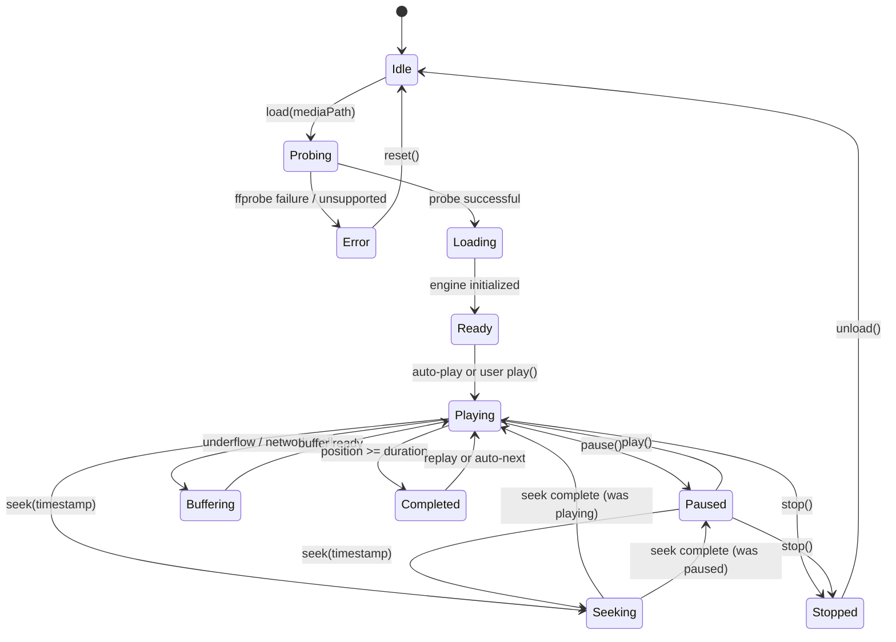
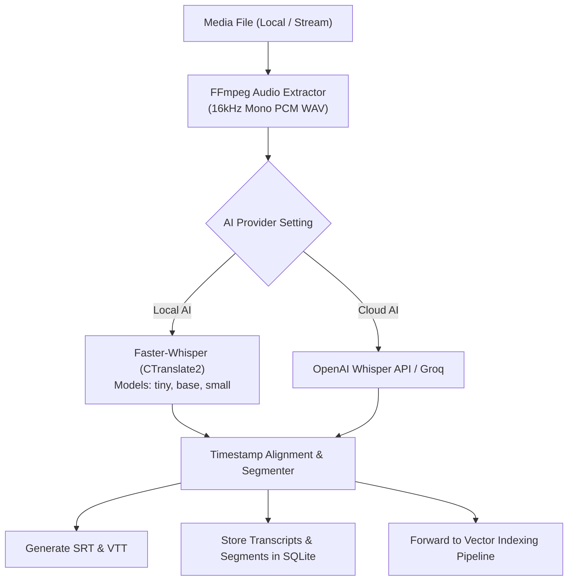

# NOVA PLAYER: Master System Architecture & Engineering Specification
**"Play Anything. Understand Everything."**
**Platform Target:** Windows 10/11 Desktop (with portable abstractions for Linux & macOS)
**Author:** Principal Software Architecture & Engineering Team

---

## Table of Contents
1. Final System Architecture
2. Architecture Diagram (Mermaid)
3. Repository Structure
4. Technology Decisions
5. Playback Engine Comparison
6. Selected Playback Engine & Justification
7. Tauri Desktop Shell Integration Design
8. Python AI Service Architecture & API Design
9. FFmpeg / ffprobe Processing Architecture
10. SQLite Database Schema & Entity Relationships
11. Unified Media Metadata Model
12. Playback State Machine
13. Subtitle Architecture & Sync Engine
14. Audio Architecture, Equalizer & DSP
15. Media Library & Non-Blocking Scanner Architecture
16. Streaming & Network Media Architecture
17. AI Audio Extraction & Transcription Architecture
18. Video RAG (Retrieval-Augmented Generation) Architecture
19. Timestamp Citation & Verification Design
20. Learning Mode Architecture (NOVA Learn)
21. Local vs. Cloud AI Provider Architecture & Privacy
22. Security Architecture & Threat Model
23. IPC Security & Typed Command Layer
24. Background Job & Asynchronous Worker Architecture
25. Performance Strategy & Hardware Acceleration
26. Comprehensive Test Matrix & Fixture Plan
27. Complete Phase Roadmap (Phases 0 - 24)

---

## 1. Final System Architecture

NOVA PLAYER is constructed as a decoupled, multi-process, local-first multimedia and intelligence platform consisting of four primary subsystems:

1. **Presentation & Interaction Layer (React Desktop App):**
   - High-performance, cinematic UI constructed with React 19 / TypeScript, Vite, Tailwind CSS, Zustand, TanStack Query, and Framer Motion.
   - Responsible for player chrome, timeline scrubbing, transcript synchronization, AI chat interface, learning workspace, media library virtualization, and settings.
   - Operates in strict client-side mode with zero reliance on cloud servers for core playback functions.

2. **Native Desktop Shell & Host Bridge (Tauri / Rust):**
   - Lightweight, secure desktop harness powered by Tauri v2.
   - Provides native window controls (frameless titlebar, always-on-top, mini-player mode, picture-in-picture, multi-monitor placement).
   - Manages OS dialogs, file associations, drag-and-drop ingestion, system tray, power management (preventing sleep during playback), and hardware diagnostics.
   - Coordinates the lifecycle of the Python AI sidecar and spawns external FFmpeg/ffprobe child processes via secure asynchronous pipes.

3. **Universal Media Engine Abstraction (`PlaybackEngine`):**
   - Decoupled interface isolating UI from the underlying video rendering backend.
   - Native backend integration: Employs a dual-pipeline strategy:
     - **Native Core Pipeline:** Native backend bindings via `libmpv`/`libVLC` providing direct D3D11 / DXVA2 hardware decoding, HDR tone-mapping, precise audio/video synchronization, and broad container/codec coverage (MKV, MP4, AVI, MOV, WebM, FLV, TS, HEVC, AV1, VP9, DTS, AC3, etc.).
     - **Web Engine Fallback / Stream Pipeline:** High-efficiency HTML5 video element with custom MSE / HLS.js / Dash.js engine for lightweight web media, HLS/DASH streams, and environments where external native libraries are not present.
   - Hardware-accelerated presentation surface with zero-copy texture sharing or borderless overlay alignment.

4. **Intelligence & Heavy Media Service (Python FastAPI Sidecar):**
   - Independent daemon executing in the background on a local loopback port (`127.0.0.1:8765`) or IPC socket.
   - Houses heavy AI and media pipelines: Whisper / Faster-Whisper for automated speech-to-text, sentence-transformers / ChromaDB for local vector embeddings, LLM orchestration (Ollama/llama.cpp local models and OpenAI/Anthropic/Gemini cloud providers), and FFmpeg-driven media operations.
   - Exposes typed REST endpoints and Server-Sent Events (SSE) for progress streaming.
   - Operates gracefully in an offline/degraded state: if the AI service is stopped, disabled, or fails to initialize, normal media playback remains 100% operational.

---

## 2. Architecture Diagram

```mermaid
graph TB
    subgraph DesktopShell["Desktop Shell (Tauri Host)"]
        WindowMgr["Window Manager<br/>(Mini-Player, PiP, Fullscreen)"]
        NativeBridge["Tauri IPC Command Bridge<br/>(Typed Invoke Handlers)"]
        ProcessMgr["Sidecar & Worker Lifecycle Manager"]
        FSBridge["Safe Filesystem & Path Validator"]
    end

    subgraph UI["Presentation Layer (React + TypeScript)"]
        PlayerView["Cinematic Video Player<br/>(Controls, Timeline, HUD)"]
        LibraryView["Media Library & Virtualized Grid"]
        TranscriptView["Synchronized Transcript Panel"]
        AIPanel["Ask This Video / RAG Panel"]
        LearnView["NOVA Learn Workspace<br/>(Notes, Flashcards, Quiz)"]
        ToolsView["FFmpeg Media Tools & Converter"]
        ZustandStore["Global State (Zustand)<br/>Player, Library, AI, Settings"]
    end

    subgraph MediaEngine["Playback Engine Abstraction"]
        EngineInterface["PlaybackEngine Interface"]
        MPVBackend["Native Backend (libmpv / libVLC)<br/>D3D11VA / DXVA2 Hardware Accel"]
        WebEngine["Webview HTML5 / MSE / HLS.js Backend"]
        AudioDSP["Audio DSP & 10-Band Equalizer"]
        SubRenderer["Custom Subtitle Renderer & Sync Engine"]
    end

    subgraph LocalStorage["Local Persistence Layer (SQLite WAL)"]
        SQLiteDB[("SQLite Database<br/>media_items, history, playlists,<br/>transcripts, notes, quizzes")]
        ThumbCache["Thumbnail & Waveform Cache Directory"]
        VectorDB[("Local Vector Index<br/>ChromaDB / sqlite-vec")]
    end

    subgraph AIService["Python AI Service (FastAPI Sidecar)"]
        APIServer["FastAPI Server (127.0.0.1:8765)"]
        STTEngine["Speech-to-Text Pipeline<br/>(Faster-Whisper / Cloud API)"]
        RAGOrchestrator["Video RAG & Retrieval Engine"]
        LLMAdapter["LLM Provider Abstraction<br/>(Local Ollama / OpenAI / Claude / Gemini)"]
        LearnEngine["Learning Mode Generator<br/>(Summaries, MCQs, Flashcards)"]
        JobQueue["Async Job Queue & Progress SSE"]
    end

    subgraph FFmpegLayer["FFmpeg & Media Processing"]
        ProbeService["MediaProbeService (ffprobe JSON)"]
        TranscodeService["Transcode & Trim Service"]
        AudioExtractService["Audio Extraction & Waveform"]
    end

    %% Connections
    UI <-->|Tauri IPC / Events| NativeBridge
    UI <-->|HTTP / SSE Progress| APIServer
    ZustandStore <--> EngineInterface
    EngineInterface --> MPVBackend
    EngineInterface --> WebEngine
    NativeBridge --> WindowMgr
    NativeBridge --> ProcessMgr
    NativeBridge --> FSBridge
    FSBridge --> SQLiteDB
    ProcessMgr --> APIServer
    APIServer --> STTEngine
    APIServer --> RAGOrchestrator
    APIServer --> LLMAdapter
    APIServer --> LearnEngine
    RAGOrchestrator --> VectorDB
    APIServer --> JobQueue
    NativeBridge --> ProbeService
    NativeBridge --> TranscodeService
    NativeBridge --> AudioExtractService
    ProbeService --> SQLiteDB
```



---

## 3. Repository Structure

```
nova-player/
│
├── apps/
│   └── desktop/
│       ├── src/
│       │   ├── assets/                 # Icons, splash media, static assets
│       │   ├── components/             # Reusable UI component library
│       │   │   ├── common/             # Button, Modal, Dropdown, Slider, Tooltip
│       │   │   ├── player/             # VideoSurface, Controls, Timeline, HUD
│       │   │   ├── media-info/         # Codec, resolution, stream inspector
│       │   │   ├── library/            # Virtualized media grid, filters, sorting
│       │   │   ├── ai/                 # TranscriptPanel, AskVideoChat, Summaries
│       │   │   ├── learning/           # NotesEditor, FlashcardDeck, QuizEngine
│       │   │   └── tools/              # ConverterModal, AudioExtractor, GIFCreator
│       │   ├── hooks/                  # Custom React hooks (usePlayer, useShortcuts)
│       │   ├── stores/                 # Zustand state stores (player, library, ai)
│       │   ├── services/               # API clients (Tauri bridge, AI service HTTP)
│       │   ├── types/                  # TypeScript interfaces and schemas
│       │   ├── utils/                  # Formatters, time math, color parsers
│       │   ├── App.tsx                 # Root application routing and layout
│       │   ├── main.tsx                # React DOM entrypoint
│       │   └── index.css               # Design tokens, Tailwind CSS base & glassmorphism
│       ├── src-tauri/
│       │   ├── src/
│       │   │   ├── commands/           # Typed IPC command handlers
│       │   │   ├── media/              # Media probing, native playback bindings
│       │   │   ├── sidecar/            # Python process supervisor & health check
│       │   │   ├── database/           # SQLite migrations & queries
│       │   │   ├── main.rs             # Tauri runtime entry & lifecycle hooks
│       │   │   └── lib.rs              # Library exports and capability registration
│       │   ├── capabilities/           # Tauri v2 security capability permissions
│       │   ├── Cargo.toml              # Rust dependencies
│       │   └── tauri.conf.json         # Window, protocol, and sidecar configuration
│       ├── package.json
│       ├── tsconfig.json
│       └── vite.config.ts
│
├── services/
│   └── ai-service/
│       ├── app/
│       │   ├── api/                    # FastAPI route controllers
│       │   │   ├── health.py           # Health check and hardware diagnostics
│       │   │   ├── transcribe.py       # Speech-to-text endpoints
│       │   │   ├── rag.py              # Video Q&A and semantic search
│       │   │   ├── summarize.py        # Summary and smart chapter generation
│       │   │   ├── learning.py         # Notes, flashcards, MCQ generation
│       │   │   └── jobs.py             # Asynchronous task polling and SSE stream
│       │   ├── core/                   # Configuration, logging, exception handlers
│       │   ├── models/                 # Pydantic schemas and database models
│       │   ├── services/               # Business logic
│       │   │   ├── stt_service.py      # Faster-Whisper engine
│       │   │   ├── rag_service.py      # Embedding & vector retrieval
│       │   │   ├── llm_service.py      # Multi-provider LLM connector
│       │   │   └── learning_service.py # Pedagogical content generation
│       │   ├── storage/                # SQLite connection and ChromaDB vector store
│       │   └── main.py                 # FastAPI application factory
│       ├── tests/                      # Pytest unit & integration tests
│       └── requirements.txt            # Python dependencies
│
├── packages/
│   ├── shared-types/                   # Shared TypeScript models (metadata, player, ai)
│   ├── ui/                             # Standalone design tokens and Tailwind theme
│   └── config/                         # ESLint, Prettier, and build configurations
│
├── media-engine/
│   ├── playback/                       # PlaybackEngine interface & implementations
│   ├── ffmpeg/                         # FFmpeg & ffprobe argument builders & executor
│   ├── metadata/                       # MediaProbeService and technical parser
│   ├── subtitles/                      # Subtitle parser (SRT/VTT/ASS), delay, styling
│   └── thumbnails/                     # Thumbnail sprite generator and cache
│
├── data/
│   ├── fixtures/                       # Legal, synthetic test media files
│   └── migrations/                     # SQLite schema migration scripts
│
├── tests/
│   ├── e2e/                            # Playwright desktop end-to-end tests
│   └── fixtures/                       # Fixture generators for audio, video, subs
│
├── docs/                               # Comprehensive engineering documentation
├── scripts/                            # Build, packaging, and setup scripts
├── .env.example                        # Template environment variables
├── README.md                           # Master project guide and setup instructions
└── package.json                        # Root workspace configuration
```

---

## 4. Technology Decisions

| Domain | Selected Technology | Version / Spec | Justification |
| :--- | :--- | :--- | :--- |
| **Desktop Shell** | Tauri | v2.x | Tiny memory footprint (~40MB vs ~180MB for Electron), native window integration, high-speed Rust IPC, secure sidecar process isolation. |
| **Frontend Framework** | React + TypeScript | 19.x / 5.8+ | Component composability, declarative UI, robust typing across state and IPC boundaries. |
| **Build Tooling** | Vite | 6.x | Sub-second HMR, optimized ESM bundling, zero-overhead desktop asset serving. |
| **State Management** | Zustand | 5.x | Minimal boilerplate, selector-based re-renders, flawless out-of-React state access for playback events. |
| **Data Fetching / Cache** | TanStack Query | 5.x | Declarative caching for library media, AI jobs, and asynchronous probe results. |
| **Styling** | Tailwind CSS + Custom CSS Variables | 3.4+ / CSS Next | Curated HSL dark palette, smooth glassmorphism, responsive grid layouts, cinematic HUD aesthetics. |
| **Icons** | Lucide React | Latest | Clean, consistent, lightweight SVG iconography. |
| **Animations** | Framer Motion | 12.x | High-performance hardware-accelerated micro-animations for HUD controls and panels. |
| **Database** | SQLite with WAL mode | 3.45+ | Zero-config, single-file desktop database capable of handling 100k+ media records with sub-millisecond queries. |
| **Python Backend** | FastAPI + Uvicorn | 0.115+ | High-throughput asynchronous REST & SSE streaming, native Pydantic schema validation. |
| **Speech-to-Text** | Faster-Whisper (Local) + Whisper API (Cloud) | CTranslate2 / OpenAI | 4x faster execution than vanilla Whisper on CPU/CUDA; seamless fallback to OpenAI Whisper API when cloud mode is enabled. |
| **Vector Search** | sqlite-vec / ChromaDB | Local embedded | In-process, zero-server vector database with cosine similarity search for transcript embeddings. |
| **Media Probe & Transcode** | FFmpeg & ffprobe | 6.x - 9.x static builds | Universal standard for media container demuxing, stream probing, transcoding, thumbnail sprites, and audio extraction. |

---

## 5. Playback Engine Comparison

To select the ideal playback engine for Windows 10/11 desktop while maintaining cross-platform extensibility, we evaluate five potential backends:

| Engine | Format Coverage | Hardware Acceleration | Subtitle Rendering | Tauri / Webview Integration | Complexity & Maintenance |
| :--- | :--- | :--- | :--- | :--- | :--- |
| **libmpv** | Excellent (plays almost any container/codec in existence) | Superb (D3D11VA, NVDEC, VAAPI, Vulkan) | Outstanding (libass native rendering, SSA/ASS styling) | Very High (requires embedding native HWND or OpenGL/D3D texture sharing via Rust) | Moderate-High (C API bindings, shared DLLs) |
| **libVLC** | Excellent (comprehensive codec coverage) | Good (DXVA2, D3D11VA) | Good (SRT, VTT, basic ASS) | High (HWND reparenting or raw video callbacks) | High (large binaries, multi-megabyte bundle) |
| **Chromium HTML5 Media + MSE** | Restricted (patent-free codecs: H.264, VP8/VP9, AV1, AAC, MP3, Opus; fails on HEVC/AC3/DTS/MKV without custom Chromium builds) | High (GPU-accelerated through Chromium) | Basic (VTT via HTML `<track>`) | Seamless (native to Webview2 on Windows) | Very Low (zero native compilation needed) |
| **GStreamer** | High (via plugins) | Good (depends on plugin pipeline) | Fair | Very High (complex C pipeline construction) | Extreme (plugin dependency hell on Windows) |
| **Windows Media Foundation** | Moderate (MS-supported formats only; fails on MKV, FLV, ASS) | Native Windows DirectX | Limited | Native Windows only | High, platform-locked |

---

## 6. Selected Playback Engine & Justification

### The Selected Architecture: Unified `PlaybackEngine` with Dual-Mode Runtime

We select a **Dual-Mode Native / Web Architecture** unified behind an abstract interface `PlaybackEngine`:

1. **Primary Production Native Mode (`MpvNativeEngine`):**
   - Built on `libmpv` (Windows `mpv-2.dll`).
   - Justification: `mpv` provides the world's most robust, crash-resilient multimedia playback core, flawless MKV/HEVC/10-bit HDR decoding, native SSA/ASS subtitle styling via `libass`, sub-frame seek accuracy, and integrated audio DSP equalizers.
   - Tauri embeds the mpv render viewport directly into the desktop application window using a dedicated Windows child HWND aligned beneath transparent React HUD controls, or renders via D3D11 swapchain.

2. **Resilient Web / Streaming Mode (`WebMediaEngine`):**
   - Built on HTML5 `<video>` augmented with `HLS.js` and `Dash.js`.
   - Justification: Enables immediate instant preview for MP4/WebM files, HLS live streams, and serves as an infallible zero-dependency fallback whenever native binary dependencies are unavailable or while running in pure development mode.
   - Supports custom WebAudio API 10-band equalizer and custom JavaScript subtitle overlays.

---

## 7. Tauri Desktop Shell Integration Design

The desktop shell is built in Rust using Tauri v2.

### Architectural Responsibilities:
1. **Window Management:**
   - Standard window: Frameless with custom draggable titlebar, min/max/close controls.
   - Fullscreen: Hardware fullscreen toggling, multi-monitor display selection.
   - Mini Player: Resizes window to 360x202, enables `always_on_top(true)`.
   - Picture-in-Picture: Uses Windows native PIP or floating borderless window.
2. **Process Supervisor:**
   - On application startup, Tauri checks if the Python AI service is running on `127.0.0.1:8765`.
   - If not running and AI is enabled in settings, Tauri spawns `services/ai-service/app/main.py` (or bundled binary) as a monitored child process.
   - Graceful shutdown: When the Tauri app exits, SIGTERM is sent to the sidecar to release ports and CUDA/CPU resources.
3. **Safe IPC Command Dispatch:**
   - All desktop operations (probing files, reading local directories, calling FFmpeg) execute as strongly typed Rust commands registered via `tauri::generate_handler![]`.

---

## 8. Python AI Service Design

The AI service operates as an independent ASGI application powered by FastAPI, listening strictly on `127.0.0.1:8765`.

### Core API Endpoints:
- `GET /health`: Returns CPU/GPU availability, loaded models, memory metrics, and status.
- `POST /media/transcribe`: Ingests video path, runs 16kHz audio extraction, dispatches Faster-Whisper, and emits segmented timestamped transcript.
- `POST /media/ask`: Video RAG endpoint. Accepts query, video ID, and current timestamp; performs hybrid vector search; and streams LLM synthesis with citations.
- `POST /media/summarize`: Generates structured summaries (Key Points, Executive Brief, Chapter Breakdown).
- `POST /media/translate`: Translates subtitle segments to target language (English, Tamil, Hindi, etc.) preserving exact timestamps.
- `POST /learning/notes`: Generates Cornell-style lecture notes with timestamp links.
- `POST /learning/flashcards`: Generates QA flashcard pairs with timestamps.
- `POST /learning/quiz`: Generates 5, 10, or 20 multiple-choice questions with answer rationale.
- `GET /jobs/{id}` & `GET /jobs/{id}/events`: Polling and SSE stream for long-running operations.

---

## 9. FFmpeg / ffprobe Architecture

To prevent shell injection and ensure maximum stability, FFmpeg and ffprobe are never invoked via raw shell strings. Instead, all executions go through structured argument builders.

### Centralized Services:
1. **`MediaProbeService`:**
   - Invokes `ffprobe -v quiet -print_format json -show_format -show_streams -show_chapters <sanitized_path>`.
   - Deserializes JSON into a strongly typed `MediaProbeResult`.
   - Computes human-readable quality labels (`720p HD`, `1080p Full HD`, `4K UHD`, `8K UHD`), validates pixel formats, detects HDR color primaries (`bt2020nc`), and catalogs all audio/subtitle streams.
2. **`FFmpegEngineService`:**
   - **Thumbnail Sprite Generator:** Generates a thumbnail grid every N seconds for instant scrub preview without blocking playback.
   - **Audio Extractor:** Extracts 16kHz mono WAV for Whisper transcription: `ffmpeg -i <file> -vn -acodec pcm_s16le -ar 16000 -ac 1 <out.wav>`.
   - **Lossless / Fast Trimmer:** Uses stream copy (`-c copy`) when keyframes align, falling back to precision re-encoding.
   - **Safe Media Transcoder:** Transcodes incompatible codecs to MP4/H.264 or WebM/VP9 with validated presets (High Quality, Balanced, Small File).

---

## 10. SQLite Database Schema

The database resides locally in the user application data directory (`%APPDATA%/NovaPlayer/nova.db`).

### Schema Definition:
```sql
-- 1. Media Items
CREATE TABLE media_items (
    id TEXT PRIMARY KEY,
    path TEXT UNIQUE NOT NULL,
    filename TEXT NOT NULL,
    media_type TEXT NOT NULL,          -- 'video' | 'audio'
    container TEXT NOT NULL,
    duration REAL NOT NULL,
    size INTEGER NOT NULL,
    width INTEGER,
    height INTEGER,
    quality_label TEXT,                -- '1080p Full HD', '4K UHD', etc.
    fps REAL,
    video_codec TEXT,
    video_bitrate INTEGER,
    audio_codec TEXT,
    audio_channels INTEGER,
    hdr INTEGER DEFAULT 0,             -- 1 if HDR, 0 if SDR
    thumbnail_path TEXT,
    date_added TEXT NOT NULL,
    last_played TEXT,
    play_count INTEGER DEFAULT 0,
    favorite INTEGER DEFAULT 0
);

-- 2. Media Tracks
CREATE TABLE media_tracks (
    id TEXT PRIMARY KEY,
    media_id TEXT NOT NULL REFERENCES media_items(id) ON DELETE CASCADE,
    track_type TEXT NOT NULL,          -- 'video' | 'audio' | 'subtitle'
    stream_index INTEGER NOT NULL,
    codec TEXT,
    language TEXT,
    title TEXT,
    channels INTEGER,
    is_default INTEGER DEFAULT 0
);

-- 3. Playback Positions (Resume)
CREATE TABLE playback_positions (
    media_id TEXT PRIMARY KEY REFERENCES media_items(id) ON DELETE CASCADE,
    position REAL NOT NULL,
    duration REAL NOT NULL,
    percentage REAL NOT NULL,
    updated_at TEXT NOT NULL,
    completed INTEGER DEFAULT 0
);

-- 4. Playback History
CREATE TABLE playback_history (
    id TEXT PRIMARY KEY,
    media_id TEXT NOT NULL REFERENCES media_items(id) ON DELETE CASCADE,
    played_at TEXT NOT NULL,
    playback_position REAL NOT NULL,
    duration REAL NOT NULL,
    completed INTEGER DEFAULT 0
);

-- 5. Playlists & Items
CREATE TABLE playlists (
    id TEXT PRIMARY KEY,
    name TEXT NOT NULL,
    created_at TEXT NOT NULL,
    updated_at TEXT NOT NULL
);

CREATE TABLE playlist_items (
    id TEXT PRIMARY KEY,
    playlist_id TEXT NOT NULL REFERENCES playlists(id) ON DELETE CASCADE,
    media_id TEXT NOT NULL REFERENCES media_items(id) ON DELETE CASCADE,
    sort_order INTEGER NOT NULL
);

-- 6. Bookmarks
CREATE TABLE bookmarks (
    id TEXT PRIMARY KEY,
    media_id TEXT NOT NULL REFERENCES media_items(id) ON DELETE CASCADE,
    timestamp REAL NOT NULL,
    title TEXT NOT NULL,
    note TEXT,
    created_at TEXT NOT NULL
);

-- 7. Subtitles
CREATE TABLE subtitles (
    id TEXT PRIMARY KEY,
    media_id TEXT NOT NULL REFERENCES media_items(id) ON DELETE CASCADE,
    source TEXT NOT NULL,              -- 'embedded' | 'external' | 'ai_generated'
    language TEXT NOT NULL,
    format TEXT NOT NULL,              -- 'srt' | 'vtt' | 'ass'
    file_path TEXT,
    is_active INTEGER DEFAULT 0
);

-- 8. Transcripts & Segments
CREATE TABLE transcripts (
    id TEXT PRIMARY KEY,
    media_id TEXT NOT NULL REFERENCES media_items(id) ON DELETE CASCADE,
    language TEXT NOT NULL,
    model_used TEXT NOT NULL,
    created_at TEXT NOT NULL
);

CREATE TABLE transcript_segments (
    id TEXT PRIMARY KEY,
    transcript_id TEXT NOT NULL REFERENCES transcripts(id) ON DELETE CASCADE,
    start_time REAL NOT NULL,
    end_time REAL NOT NULL,
    text TEXT NOT NULL,
    confidence REAL
);

-- 9. AI Summaries & Smart Chapters
CREATE TABLE ai_summaries (
    id TEXT PRIMARY KEY,
    media_id TEXT NOT NULL REFERENCES media_items(id) ON DELETE CASCADE,
    summary_type TEXT NOT NULL,        -- 'short' | 'detailed' | 'key_points'
    content TEXT NOT NULL,
    created_at TEXT NOT NULL
);

CREATE TABLE ai_chapters (
    id TEXT PRIMARY KEY,
    media_id TEXT NOT NULL REFERENCES media_items(id) ON DELETE CASCADE,
    start_time REAL NOT NULL,
    end_time REAL NOT NULL,
    title TEXT NOT NULL,
    summary TEXT
);

-- 10. Learning Mode: Notes, Flashcards, Quizzes
CREATE TABLE notes (
    id TEXT PRIMARY KEY,
    media_id TEXT NOT NULL REFERENCES media_items(id) ON DELETE CASCADE,
    timestamp REAL,
    title TEXT NOT NULL,
    content TEXT NOT NULL,
    note_type TEXT NOT NULL,           -- 'quick' | 'detailed' | 'exam'
    created_at TEXT NOT NULL
);

CREATE TABLE flashcards (
    id TEXT PRIMARY KEY,
    media_id TEXT NOT NULL REFERENCES media_items(id) ON DELETE CASCADE,
    question TEXT NOT NULL,
    answer TEXT NOT NULL,
    timestamp REAL,
    box INTEGER DEFAULT 1,             -- Spaced repetition Leitner box (1-5)
    last_reviewed TEXT
);

CREATE TABLE quizzes (
    id TEXT PRIMARY KEY,
    media_id TEXT NOT NULL REFERENCES media_items(id) ON DELETE CASCADE,
    title TEXT NOT NULL,
    created_at TEXT NOT NULL
);

CREATE TABLE quiz_questions (
    id TEXT PRIMARY KEY,
    quiz_id TEXT NOT NULL REFERENCES quizzes(id) ON DELETE CASCADE,
    question TEXT NOT NULL,
    options_json TEXT NOT NULL,        -- JSON array of 4 options
    correct_option_index INTEGER NOT NULL,
    explanation TEXT NOT NULL,
    timestamp REAL NOT NULL
);

CREATE TABLE quiz_attempts (
    id TEXT PRIMARY KEY,
    quiz_id TEXT NOT NULL REFERENCES quizzes(id) ON DELETE CASCADE,
    score INTEGER NOT NULL,
    total INTEGER NOT NULL,
    weak_topics_json TEXT,
    attempted_at TEXT NOT NULL
);

-- 11. Application Settings & Library Folders
CREATE TABLE library_folders (
    id TEXT PRIMARY KEY,
    folder_path TEXT UNIQUE NOT NULL,
    date_added TEXT NOT NULL,
    last_scanned TEXT
);

CREATE TABLE settings (
    key TEXT PRIMARY KEY,
    value TEXT NOT NULL
);

-- Indices for instant lookup
CREATE INDEX idx_media_path ON media_items(path);
CREATE INDEX idx_media_type ON media_items(media_type);
CREATE INDEX idx_trans_media ON transcripts(media_id);
CREATE INDEX idx_trans_seg ON transcript_segments(transcript_id, start_time);
CREATE INDEX idx_pos_media ON playback_positions(media_id);
```

---

## 11. Unified Media Metadata Model

Metadata is parsed strictly from `ffprobe` stream metadata, never guessed from file extensions or names.

```typescript
export interface AudioStreamInfo {
  index: number;
  codec: string;
  channels: number;
  channelLayout: string;
  sampleRate: number;
  bitrate?: number;
  language?: string;
  title?: string;
  isDefault: boolean;
}

export interface SubtitleStreamInfo {
  index: number;
  codec: string;
  language?: string;
  title?: string;
  isForced: boolean;
  isDefault: boolean;
}

export interface MediaMetadata {
  id: string;
  path: string;
  filename: string;
  fileSize: number;
  container: string;
  duration: number; // in seconds
  bitrate: number;
  
  // Video Stream (if present)
  hasVideo: boolean;
  width?: number;
  height?: number;
  qualityLabel?: string; // '720p HD' | '1080p Full HD' | '4K UHD', etc.
  fps?: number;
  videoCodec?: string;
  pixelFormat?: string;
  colorSpace?: string;
  isHdr: boolean;
  hdrFormat?: string; // 'HDR10' | 'HLG' | 'Dolby Vision'

  // Audio Streams
  hasAudio: boolean;
  audioStreams: AudioStreamInfo[];
  activeAudioIndex: number;

  // Subtitles
  subtitleStreams: SubtitleStreamInfo[];
  activeSubtitleIndex: number; // -1 for disabled

  // Chapters
  chapters: Array<{
    id: number;
    start: number;
    end: number;
    title: string;
  }>;
}
```

---

## 12. Playback State Machine



---

## 13. Subtitle Architecture & Sync Engine

1. **Format Parsers:** Pure TypeScript parser for SRT, WebVTT, and ASS dialogue events.
2. **Synchronization:** Real-time delay adjustment with fine slider: `-2.00s` to `+2.00s` (in 50ms increments).
3. **Styling Engine:** Configurable font family, font size (14px to 48px), bold/italic, font color, text outline/shadow, semi-transparent background box, and vertical positioning.
4. **Dual Subtitle Engine:** Renders primary language (e.g., English) on the bottom and secondary translation (e.g., Tamil or Hindi) on top for language acquisition.

---

## 14. Audio Architecture, Equalizer & DSP

1. **Volume Management:** Linear to logarithmic volume scaling; safe preamp up to +6dB with a hard peak limiter to eliminate digital clipping.
2. **10-Band Graphic Equalizer:**
   - Centers: 60Hz, 170Hz, 310Hz, 600Hz, 1kHz, 3kHz, 6kHz, 12kHz, 14kHz, 16kHz.
   - Gain range: -12dB to +12dB.
   - Built-in presets: Flat, Bass Boost, Treble Boost, Rock, Pop, Classical, Movie Dialogue, Voice Clarity.
3. **Audio / Video Sync:** Audio delay slider adjusting output timing from `-500ms` to `+500ms`.
4. **Dynamic Range Normalization:** RMS-based volume normalization for dialogue clarity during quiet scenes.
5. **Real-Time Visualizer:** WebAudio `AnalyserNode` rendering high-fps frequency spectrum and oscillogram waveform (toggleable to preserve GPU resources).

---

## 15. Media Library Architecture

1. **Explicit Folder Registration:** User explicitly selects library directories; the app never scans arbitrary drives automatically.
2. **Non-Blocking Background Scanner:** Scans filesystem asynchronously using recursive directory streams without freezing the UI.
3. **Deduplication:** Computes fast 64KB head/tail cryptographic hashes combined with file size to identify duplicates without deleting them automatically.
4. **Virtualization:** Uses TanStack Virtual to render libraries with 50,000+ items at 60 FPS.

---

## 16. Streaming & Network Media Architecture

1. **Supported Protocols:** Direct HTTP/HTTPS progressive video/audio, HLS (`.m3u8`), and MPEG-DASH (`.mpd`).
2. **Stream Validation:** Pre-flight headers inspect content-type before initiating buffer allocation.
3. **Adaptive Bitrate (ABR):** Automatically detects variants exposed in HLS manifests and allows manual quality override (Auto, 1080p, 720p, 480p).
4. **Buffer Presets:** Auto (default 30s), Low Latency (5s buffer for live feeds), Stable (60s buffer for high-jitter connections).
5. **Strict No-DRM Policy:** Reject DRM-locked, encrypted widevine streams with clear, informative user messaging.

---

## 17. AI Audio Extraction & Transcription Architecture



---

## 18. Video RAG Architecture (Ask This Video)

1. **Sliding-Window Segmentation:** Transcript segments are coalesced into semantic chunks (approx. 100-150 words with 25-word overlap), retaining exact start/end timestamps.
2. **Vector Indexing:** Chunks are vectorized using `all-MiniLM-L6-v2` (local) or `text-embedding-3-small` (cloud) and stored in the local vector index.
3. **Hybrid Retrieval:** User question triggers BM25 keyword matching + Cosine Vector Similarity.
4. **Context Injection:** Top-K retrieved chunks with timestamps are provided to the LLM with strict instructions: "Only answer based on the provided transcript excerpt. Cite exact timestamps."

---

## 19. Timestamp Citation & Verification Design

- Every claim generated by the LLM contains a markdown citation: `[HH:MM:SS]`.
- Frontend parses these tokens into interactive buttons.
- Clicking any timestamp triggers `playbackEngine.seek(seconds)` and scrolls the synchronized transcript panel into view.
- Strict provenance verification: Citations are validated against actual retrieved chunk intervals to eliminate hallucinations.

---

## 20. Learning Mode Architecture (NOVA Learn)

1. **Topic Segmentation:** Analyzes transcript pauses and semantic shifts to generate logical chapter divisions.
2. **AI Notes Generator:** Produces markdown notes categorized as Executive Summary, Core Concepts, and Detailed Timeline Breakdown.
3. **Flashcard Engine:** Automatically creates Leitner-box question/answer flashcards with review tracking.
4. **MCQ Quiz Engine:** Formulates 5 to 20 multiple-choice questions with 4 distinct options, rationale, and direct video timestamp links for revision.

---

## 21. Local vs. Cloud AI Provider Architecture & Privacy

- **Local-First Default:** All core player functions, metadata probing, and playback operate completely offline.
- **Provider Switching:**
  - **STT:** Local Faster-Whisper vs. Cloud Whisper API.
  - **LLM:** Local Ollama (`llama3.2`, `mistral`, `phi-3`) vs. Cloud (OpenAI GPT-4o-mini, Anthropic Claude, Google Gemini).
- **Privacy Enforcement:** Never uploads whole video files to any cloud service. Cloud AI mode only sends extracted text transcripts or 16kHz audio slices if explicitly consented to by the user.

---

## 22. Security Architecture & Threat Model

1. **No Arbitrary Shell Execution:** Never invoke `cmd.exe` or PowerShell directly. External binaries (`ffmpeg`, `ffprobe`) are executed with explicit argument vectors.
2. **Path Traversal Guards:** All file paths are normalized and validated to ensure they reside in user-accessible storage.
3. **Content Security Policy (CSP):** Strict CSP blocking inline eval and unwhitelisted script origins.
4. **Secret Storage:** Cloud API keys are stored securely using OS credential storage or encrypted local settings.

---

## 23. IPC Security & Typed Command Layer

All communications between the React UI and Tauri Rust host use strongly typed command signatures:
```typescript
// IPC Method Signatures
type TauriCommands = {
  probe_media: { path: string } => Promise<MediaMetadata>;
  scan_directory: { path: string } => Promise<string[]>;
  save_playback_position: { mediaId: string; position: number; duration: number } => Promise<void>;
  generate_thumbnails: { mediaPath: string; interval: number } => Promise<string>;
  execute_ffmpeg_task: { task: FFmpegTaskConfig } => Promise<string>;
};
```

---

## 24. Background Job & Asynchronous Worker Architecture

- Long-running operations (transcription, conversion, thumbnail generation) are queued in an asynchronous worker pool.
- Each job has a state machine: `QUEUED -> PROCESSING -> COMPLETED | FAILED | CANCELLED`.
- Progress is broadcasted to the frontend via Server-Sent Events (SSE) or Tauri events, updating progress bars without freezing the UI.

---

## 25. Performance Strategy

1. **Hardware-Accelerated Decoding:** D3D11VA / DXVA2 hardware decoding enabled by default.
2. **Zero-Copy Rendering:** Direct GPU surface rendering for video frames.
3. **UI Virtualization:** Virtualized rendering for library grids and long transcript lists.
4. **Debounced Persistence:** Playback positions are persisted to SQLite with debounced writes (every 3 seconds) to prevent I/O thrashing.

---

## 26. Comprehensive Test Matrix & Fixture Plan

| Fixture Type | Format / Codec | Expected Behavior |
| :--- | :--- | :--- |
| **Standard Video** | MP4 (H.264 / AAC) | Seamless native & webview playback, 1080p label |
| **Modern Video** | MKV (HEVC 10-bit / AC3) | Native playback, HDR detection, correct resolution |
| **Open Video** | WebM (VP9 / Opus) | 4K UHD label, zero-lag seeking |
| **High Efficiency** | MP4 (AV1 / Opus) | HW decode fallback if hardware lacks AV1 ASIC |
| **Audio Only** | MP3, FLAC 24-bit, AAC | Music mode layout, album art extraction, equalizer |
| **Multi-Track** | MKV (2 Audio + 2 Subtitle tracks) | Instant track switching without restart |
| **Subtitles** | External SRT, VTT, ASS | Accurate styling, delay sync test |
| **Corrupted Media**| Truncated / malformed header | Graceful error prompt, no application crash |

---

## 27. Complete Phase Roadmap (Phases 0 - 24)

- **Phase 0:** Master Architecture, Monorepo Setup, Tooling & Verification *(Current)*
- **Phase 1:** Desktop Shell + React UI Design System + SQLite Database + Settings
- **Phase 2:** Playback Engine Abstraction & Native/Web Engine Integration
- **Phase 3:** Core Cinematic Player Controls, HUD & Timeline Scrubbing
- **Phase 4:** Media Probing, Quality/Resolution Detection & Media Info Inspector
- **Phase 5:** Audio, Video & Subtitle Track Management
- **Phase 6:** Media Library & Non-Blocking Folder Scanner
- **Phase 7:** History, Continue Watching, Favorites, Playlists & Queue
- **Phase 8:** Advanced Playback (Speed, Aspect Ratio, Zoom, Rotation, A-B Repeat, Bookmarks, Screenshots, Mini-Player)
- **Phase 9:** 10-Band Equalizer, Audio Delay, Volume Normalization & Visualizer
- **Phase 10:** Network Streams (HLS, DASH, Direct URLs, ABR)
- **Phase 11:** FFmpeg Media Tools (Transcoder, Audio Extractor, Subtitle Extractor, Trim, GIF)
- **Phase 12:** Python AI Service Core & FastAPI Server
- **Phase 13:** Audio Extraction, Speech-to-Text & AI Subtitle Generator
- **Phase 14:** AI Subtitle Translation & Dual Subtitles Mode
- **Phase 15:** Video RAG & "Ask This Video" Flagship Feature
- **Phase 16:** Semantic Video Search & Clickable Timestamp Citations
- **Phase 17:** AI Video Summarizer & Smart Chapter Generator
- **Phase 18:** NOVA Learn: Lecture Learning Workspace
- **Phase 19:** AI Notes, Spaced-Repetition Flashcards & MCQ Quiz Generator
- **Phase 20:** Local & Cloud AI Configuration (Ollama, Whisper, OpenAI, Claude, Gemini)
- **Phase 21:** Performance Optimization & Hardware Acceleration Tuning
- **Phase 22:** Security Hardening, Path Validation & Secret Redaction
- **Phase 23:** Packaging, Desktop Installer & File Association Setup
- **Phase 24:** End-to-End Verification, Test Fixtures & Quality Gate
